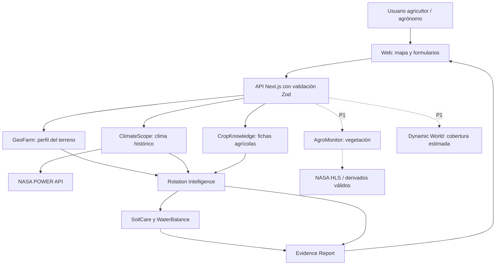

# Arquitectura técnica propuesta — AgroOrbit Nexus

**Estado:** propuesta; no se afirma que exista una implementación verificada.

## 1. Stack

| Capa | Tecnología prevista | Motivo |
|---|---|---|
| Web/UI | Next.js, React, TypeScript | App web y experiencia interactiva |
| Estilos | Tailwind CSS, shadcn/ui | Componentes consistentes |
| Mapa | MapLibre GL JS | Localización y posibles polígonos |
| Gráficos | Recharts | Series y comparaciones |
| API de aplicación | Capacidades de servidor Next.js | Validar, consultar y orquestar |
| Esquemas | Zod | Entradas/respuestas verificables |
| Motor de rotaciones | TypeScript | Reglas trazables y reproducibles |
| Tests | Vitest | Casos de cálculo y datos |
| Repositorio | GitHub | Colaboración y evidencias |
| Alojamiento (tentativo) | Vercel u opción compatible | Publicación de prototipo |

## 2. Diagrama de módulos



## 3. Límites y contratos

**Servidor:** recibe coordenadas/intervalos validables; limita solicitudes y maneja errores. Normaliza datos científicos **sin alterar sus significados**, conserva metadatos y unidades. No descargaría catálogos completos ante una interacción individual.

**Datos:** cliente no confía en supuestos; todo servicio de fuentes externas debe exponer `source`, `retrievedAt`, `period`, `units`, `qualityFlags`, `missingValues`, `spatialResolution` cuando aplique.

**Motor:** implementa funciones puras separadas de la UI: `validateRotation`, `evaluateConstraints`, `calculateIndicators`, `compareAlternatives`, `buildExplanation`. Nombres ilustrativos, no afirmación de funciones creadas.

**Estado:** la primera versión podría funcionar sin base de datos. Guardar localmente datos no sensibles por sesión; para publicación o almacenamiento persistente, revisar privacidad y necesidad real.

## 4. Flujo de datos

1. Usuario selecciona lugar y aporta datos locales.
2. Zod valida coordenadas, rangos y campos desconocidos.
3. Integrador POWER consulta el período solicitado, aplica caché razonable y guarda procedencia.
4. Catálogo agronómico aporta duraciones y requisitos **de la especie/variedad pertinente**.
5. Reglas descartan incompatibilidades comprobadas y dejan indeterminados los aspectos sin datos.
6. Indicadores se calculan con unidades consistentes.
7. Informe muestra alternativas, evidencias y advertencias; nunca traduce ausencia de datos en cero.
8. (P1) Una serie NDVI histórica puede anexarse como **observación contextual**, no como prueba causal de monocultivo.

## 5. Estructura de código sugerida (aún no existente)

```text
src/
  app/                    # Páginas, rutas y endpoints
  components/             # Mapa, tablas, formularios y visualizaciones
  features/
    geofarm/
    climate-scope/
    crop-knowledge/
    rotation-intelligence/
    soil-care/
    water-balance/
    evidence-report/
    agro-monitor/         # P1
  lib/
    sources/              # Clientes NASA y otras fuentes
    validation/           # Esquemas Zod
    science/              # Fórmulas y restricciones
    provenance/           # Metadatos de procedencia
  tests/
```

## 6. Decisiones científicas de arquitectura

- Las reglas y coeficientes **no se incorporan** sin fuente y contexto local.
- POWER ofrece información climática de grilla; no describe con precisión intraparcela.
- HLS usa series de reflectancia; seleccionar productos, calidad y ventanas fenológicas antes del cálculo.
- Una capa Dynamic World clasifica cobertura con incertidumbre; no determina titularidad ni cultivo exacto.
- No convertir puntajes multicriterio en «probabilidades» ni «precisión» de un modelo.

## 7. Aspectos por decidir

Identificar el polígono piloto, ficha de cultivos, rangos de fechas, acceso efectivo a escenas satelitales, política de caché, necesidad de exportación y posible sistema de almacenamiento. Registrar resoluciones en [`STATUS.md`](STATUS.md).
