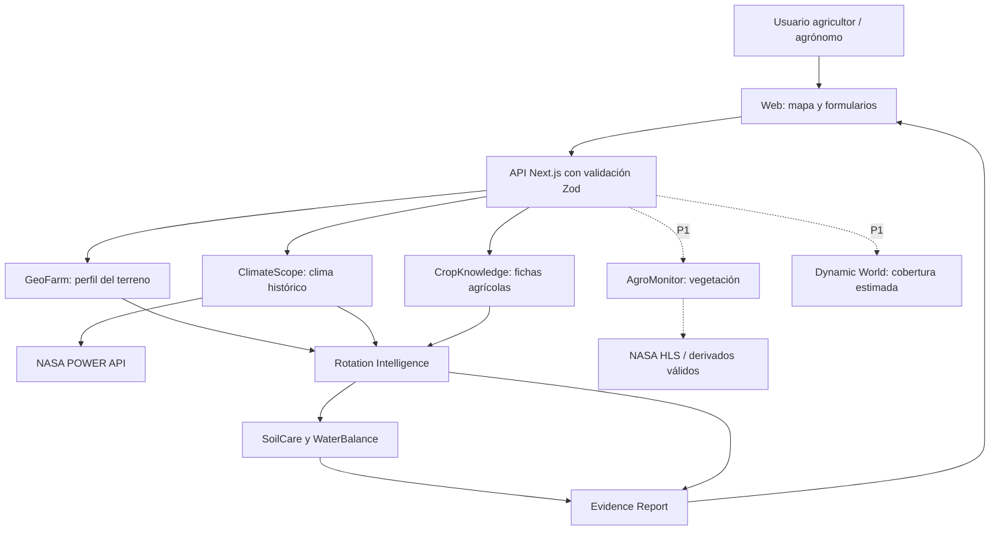

# Arquitectura técnica propuesta — AgroOrbit Nexus

**Estado actualizado 2026-11-14:** implementación P0 local en Next.js 16 / React 19. El resto del documento conserva el diseño de referencia; las diferencias reales se detallan a continuación.

## Implementación real

**Búsqueda de terreno:** `location-search.tsx` ofrece búsqueda explícita y GPS con permiso; `geocoding.ts` normaliza coincidencias y aplica caché/deduplicación/intervalo entre solicitudes; `/api/locations` valida y controla errores. El componente permite Enter sin enviar el formulario climático y conserva opciones manuales ante fallo. Detalles/condiciones: LOCATION_SEARCH.

**Ampliación global:** `regions.ts` y `locales.ts` separan ámbito/validación/idioma; catálogo ampliable genera los IDs de validación; `examples/viru.ts` aísla el caso de demo. `sources.ts` registra fuentes y límites de WorldCover. Motor devuelve cero estrategias en clima global; fuera de la demo solo comprueba la secuencia aportada. Ninguna plantilla regional se aplica por defecto. El contrato de reglas está definido, pero no hay umbrales agronómicos regionales aprobados ni recomendaciones habilitadas. Véase GLOBAL_SCOPE.

- `src/lib/model.ts`: Zod, fechas y contratos GeoFarm/ClimateScope.
- `src/lib/power.ts`: integración pública Daily/point, cuatro variables, validación de unidades, fill y calendario completo. Caché en memoria 24 h, máximo 64 consultas exactas y 4 peticiones concurrentes, deduplicación en vuelo y timeout 25 s. No es una cuota global ni caché compartida entre instancias; no se redondean coordenadas a celdas supuestas. Agrupación por celda nativa pendiente.
- `src/lib/catalog.ts`: CropKnowledge, tres especies, rangos FAO generales; sin validación regional.
- `src/lib/rotations.ts`: RotationIntelligence, indicadores SoilCare y salida WaterBalance incompleta. Funciones puras: `evaluateStrategy`, `compareStrategies`, `maxRepeat`, `buildReport`. No se calcula ETc.
- `src/app/api/analyze/route.ts`: POST con validación servidor, cuerpo máximo 32 KiB y consulta histórica. Fallo NASA produce informe parcial con error explícito.
- `src/components/workspace.tsx`: flujo sin login, edición de campañas, comparación, exportación JSON e impresión. Mapa y gráfica se cargan dinámicamente. Formularios nativos; no se añadió shadcn/ui para duplicar estos controles. Tailwind 4 y CSS con tokens.
- `farm-map.tsx`: MapLibre y teselas OSM con atribución; coordenadas alternativas. Selección de punto, no catastro.
- Worker MapLibre ESM autoalojado: postinstall copia el archivo y su BSD-3-Clause desde la versión fijada a `public/vendor/`. Se excluye este artefacto generado del lint y de Git; no se desactiva el lint de código propio.
- `climate-chart.tsx`: Recharts y tabla alternativa con completitud mensual. Sin animación de datos.
- Datos en memoria del navegador; sin base de datos ni almacenamiento persistente. API recibe perfil para procesar, consulta coordenadas/fechas a NASA; OSM recibe solicitudes de teselas. No se envían nombres del terreno a NASA.
- AgroMonitor y capas agrícolas: no implementados. Despliegue externo pendiente.

La comparación es una exploración histórica de 540 días. B/C usan inicios separados por 180 días y duraciones de escenario explícitas, dentro de rangos generales. No es una proyección ni un calendario recomendado.

## 1. Stack

| Capa | Tecnología prevista | Motivo |
|---|---|---|
| Web/UI | Next.js, React, TypeScript | App web y experiencia interactiva |
| Estilos | Tailwind CSS, shadcn/ui | Componentes consistentes |
| Mapa | MapLibre GL JS | Localización y posibles polígonos |
| Gráficos | Recharts | Series y comparaciones |
| API de aplicación | Capacidades de servidor Next.js | Validar, consultar y orquestar |
| Esquemas | Zod | Entradas/respuestas verificables |
| Motor de rotaciones | TypeScript | Reglas trazables y reproducibles |
| Tests | Vitest | Casos de cálculo y datos |
| Repositorio | GitHub | Colaboración y evidencias |
| Alojamiento (tentativo) | Vercel u opción compatible | Publicación de prototipo |

## 2. Diagrama de módulos



## 3. Límites y contratos

**Servidor:** recibe coordenadas/intervalos validables; limita solicitudes y maneja errores. Normaliza datos científicos **sin alterar sus significados**, conserva metadatos y unidades. No descargaría catálogos completos ante una interacción individual.

**Datos:** cliente no confía en supuestos; todo servicio de fuentes externas debe exponer `source`, `retrievedAt`, `period`, `units`, `qualityFlags`, `missingValues`, `spatialResolution` cuando aplique.

**Motor:** implementa funciones puras separadas de la UI: `validateRotation`, `evaluateConstraints`, `calculateIndicators`, `compareAlternatives`, `buildExplanation`. Nombres ilustrativos, no afirmación de funciones creadas.

**Estado:** la primera versión podría funcionar sin base de datos. Guardar localmente datos no sensibles por sesión; para publicación o almacenamiento persistente, revisar privacidad y necesidad real.

## 4. Flujo de datos

1. Usuario selecciona lugar y aporta datos locales.
2. Zod valida coordenadas, rangos y campos desconocidos.
3. Integrador POWER consulta el período solicitado, aplica caché razonable y guarda procedencia.
4. Catálogo agronómico aporta duraciones y requisitos **de la especie/variedad pertinente**.
5. Reglas descartan incompatibilidades comprobadas y dejan indeterminados los aspectos sin datos.
6. Indicadores se calculan con unidades consistentes.
7. Informe muestra alternativas, evidencias y advertencias; nunca traduce ausencia de datos en cero.
8. (P1) Una serie NDVI histórica puede anexarse como **observación contextual**, no como prueba causal de monocultivo.

## 5. Estructura de código sugerida (aún no existente)

```text
src/
  app/                    # Páginas, rutas y endpoints
  components/             # Mapa, tablas, formularios y visualizaciones
  features/
    geofarm/
    climate-scope/
    crop-knowledge/
    rotation-intelligence/
    soil-care/
    water-balance/
    evidence-report/
    agro-monitor/         # P1
  lib/
    sources/              # Clientes NASA y otras fuentes
    validation/           # Esquemas Zod
    science/              # Fórmulas y restricciones
    provenance/           # Metadatos de procedencia
  tests/
```

## 6. Decisiones científicas de arquitectura

- Las reglas y coeficientes **no se incorporan** sin fuente y contexto local.
- POWER ofrece información climática de grilla; no describe con precisión intraparcela.
- HLS usa series de reflectancia; seleccionar productos, calidad y ventanas fenológicas antes del cálculo.
- Una capa Dynamic World clasifica cobertura con incertidumbre; no determina titularidad ni cultivo exacto.
- No convertir puntajes multicriterio en «probabilidades» ni «precisión» de un modelo.

## 7. Aspectos por decidir

Identificar el polígono piloto, ficha de cultivos, rangos de fechas, acceso efectivo a escenas satelitales, política de caché, necesidad de exportación y posible sistema de almacenamiento. Registrar resoluciones en [`STATUS.md`](STATUS.md).
